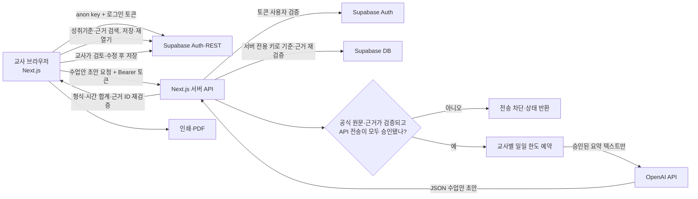

# 기말과제 앱 개발 계획 및 완료 현황

## 2026-11-23 무료 운영 구성

아래 OpenAI 연결 계획을 Workers AI 바인딩으로 대체했다. 수업안은 IndexedDB에 저장하고, 생성 한도만 SQLite Durable Object에 기록한다. Workers Free의 일일 무료 AI 할당량 소진 시 오류를 안내한다. 실제 배포와 모델 생성은 계정 인증과 Turnstile 설정 후 확인한다.

## 최신 진행 상태: 정적 Pages + Workers 전환 (2026-11-22)

아래의 기존 Supabase/Vercel 계획은 이전 운영안 기록이며 현재 결정된 운영 구조가 아닙니다. 코드는 기존 Git 저장소를 유지하고, 화면은 Next.js 정적 내보내기 + GitHub Pages (`/curriculum-inquiry-app/`), 브라우저 로그인 없음, 수업안 저장은 IndexedDB, 실시간 생성은 Cloudflare Workers + 서버 측 OpenAI로 전환합니다. Supabase와 Vercel은 운영 경로에서 제외했습니다.

이번 구현에는 성취기준 정적 검색, 교과서 연계 불가 안내, 교사 편집·검토·시간 배분·기록표·인쇄, 브라우저 저장 CRUD 및 백업/복원, Worker의 Turnstile 서버 검증과 입력·출력·시간·지속 사용량 제한, Pages 산출물 민감자료 점검이 포함됩니다. 실제 AI/Cloudflare/GitHub 계정 연결과 배포는 아직 수행하지 않았습니다. 브라우저 자동 검증의 Worker 응답은 모의 응답이며 실제 서비스 증거로 기록하지 않습니다.

### 남은 실제 서비스 단계

1. 사용자가 Cloudflare 계정에서 Worker 및 Turnstile 구성을 준비하고 Secret을 Worker에 직접 입력합니다.
2. 사용자가 OpenAI API 프로젝트·키·모델과 사용량 예산을 준비합니다. 실제 호출은 사용자 설정 후에만 검증합니다.
3. Worker 허용 Origin, 실제 Pages 주소, 공개 Turnstile 키와 API URL을 연결합니다.
4. GitHub Pages Actions를 활성화한 뒤 배포하고 실제 URL 하위 경로, 모바일, 오류/빈 화면을 점검합니다.
5. 실제 AI 생성·저장·재열기·수정·삭제·백업/복원·인쇄를 분리 기록합니다. 수업안의 과학적 내용은 교사가 검토합니다.

DB 또는 API 관련 과제 가산점은 확정된 것으로 표현하지 않습니다. 자료 표시·클라우드 저장·API 전송 허가도 각각 확인되기 전까지 비활성입니다.

**기록 보존 안내:** 이 절 아래의 기존 설계·단계표·비용표는 Supabase/Vercel 결정 당시의 과거 계획 스냅샷입니다. 최신 실행 지침이나 현재 구현 상태로 사용하지 않습니다. 이력 보존을 위해 지우지 않았으며 실제 현재 상태는 위 요약과 [CHECKLIST.md](CHECKLIST.md), [README.md](README.md)를 따릅니다.

기준일: 2026-11-22

## 목표와 자료 원칙

2022 개정 중학교 과학 성취기준을 근거로, 사용자가 고른 성취기준·교과서 단원·차시·수업 시간·장비·학생 조건에 맞춰 탐구 수업안 초안을 만든다. 교과 내용 이해에서 출발해 학생의 직접 자료 수집, 근거에 따른 설명, 새로운 실생활 문제 적용과 과정 평가로 연결한다.

- 교육과정 고시 원문과 AI가 작성한 수업 설계를 분리하고, 공식 출처와 성취기준 코드를 함께 표시한다.
- 검증된 교과서 쪽수·차시만 출처로 사용한다. 확인하지 못한 범위는 미확보·미검증으로 표시하고 생성 근거로 가장하지 않는다.
- 과학 3은 2015 개정 교과서의 내용만 참고하고, 2022 개정 성취기준을 기준으로 설계한다.
- 원본 PDF, 추출 텍스트, 검토 목록, 비밀 키는 공개 저장소나 외부 API로 전송하지 않는다. 교과서 자료 표시·클라우드 저장·API 전송 권한이 확인될 때까지 모두 비활성 상태를 유지한다.

## 구성과 데이터 흐름

현재 저장소 코드의 흐름을 기준으로 정리했다. 제품 기능을 추가하는 구현 단계가 아니라, 승인 게이트와 서비스 경계를 확인하기 위한 설계도다.

- 현재 클라이언트는 Supabase anon key와 로그인 토큰으로 성취기준·근거 검색, 수업안 저장·재열기를 요청한다. 사용자별 저장 권한은 RLS 정책으로 다시 제한한다.
- 생성 API는 Bearer 토큰과 입력 형식을 확인한 뒤, 서버 전용 키로 선택한 기준·교과서 근거를 다시 읽고 `verified`, 표시 허가, 판본·단원·차시 범위를 점검한다. 실제 모델 호출 직전에는 기준 `api_allowed`와 근거 `api_allowed` 및 요약이 있어야 진행하며 교사별 일일 한도를 예약한다.
- 승인된 호출의 입력은 공식 성취기준 문구, 승인된 교과서 요약, 교사 입력의 시간·장비·수업 차시·학급 조건이다. PDF 원본·전체 OCR·비공개 검토 목록·교과서 이미지나 페이지 원문은 전송하지 않는다. `store:false`를 요청한다.
- 학생 이름, 연락처, 건강·가정 정보 같은 식별·민감 정보는 학급 조건에 입력하지 않는다. 모델 결과는 성취기준 일치를 자동 확정하지 않으며 교사 검토 상태로 반환한다.
- 미리보기·운영 배포를 시작하기 전에는 Vercel 환경변수 분리, 서버 번들 비밀키 검사, RLS 계정 간 격리, 외부 요청 로그에 원문이 남지 않는지 확인한다.

## 교육과정 MCP 출처 사용 원칙

사용자가 지정한 [korean-secondary-learning-map-mcp 저장소](https://github.com/raphysicst-create/korean-secondary-learning-map-mcp)는 성취기준을 검색하고 비교하는 데이터 조회 도구로 쓴다. 저장소 README가 공식 교육기관 산출물이 아니며 2026-1호 별책 3·4 개정분이 반영되지 않았다고 밝히므로, 공식 원문 표시는 교육부 고시 제2022-33호 별책 9를 기준으로 한다. 해당 2026-1호의 개정 대상은 별책 1·2·3·4·15이며 과학과 별책 9는 포함되지 않았다. 국가교육위원회 공개 모니터링 자료에는 학교스포츠클럽 시간을 102시간에서 136시간으로 복원하자는 검토가 기록되어 있지만, 개정 별책의 해당 조항 전문을 직접 대조하지 않아 최종 반영 수치는 확정하지 않는다. 앱은 학교 총괄 시수에서 한 차시 수업시간을 추정하지 않고 교사가 입력한 시간만 사용한다. MCP의 학습 지도·주제·추론 정보는 AI 해석/보조 데이터로 분리해 공식 원문처럼 인용하지 않는다.
## 단계와 완료 기준

### 수업안 교육과정·탐구 품질 인수 기준

현재 생성 프롬프트와 교사 편집 화면은 아래 구조를 제공한다. 자동 JSON·시간·근거 ID 검사는 형식과 범위를 보장할 뿐, 과학적 사실의 정확성이나 학생에게 적절한 탐구인지를 판정하지 않는다. 실제 제출 전에는 승인된 자료로 만든 수업안을 과학 교사가 검토해야 한다.

| 목표 연결 | 결과에서 확인할 항목 | 교사 인수 판단 | 자동으로 확인하는 범위 |
|---|---|---|---|
| 교과 내용 이해 | 공식 성취기준·출처, 학습 목표, 핵심 개념 | 목표·개념이 해당 성취기준의 지식 요소와 맞고 오개념이 없는가 | 기준 검증 상태와 필수 텍스트 필드 존재. 개념의 과학적 진위는 자동 보증하지 않음 |
| 학생의 직접 탐구 | 탐구 질문, 학생 직접 탐구 절차, 준비물·안전, 시간 단계 | 학생이 변인을 다루거나 관찰·측정을 실제 수행하고, 시간·장비·안전 조건에 맞는가 | 단계별 분이 입력 시간과 일치하고 장비·조건 입력을 모델에 전달. 탐구의 타당성은 교사 검토 |
| 근거를 사용한 설명 | 빈 관찰·측정 기록표, 설명 작성 방법 | 학생 기록과 주장·근거·과학 개념이 연결되며 관찰값을 미리 지어내지 않았는가 | 기록표 열 2–5개·빈 행 2–8개, 측정 예시값 미포함, 선택된 근거 ID만 반환 |
| 새 실생활 문제 적용 | 새로운 문제와 적용 과제, 과정 평가 | 익숙한 예시 반복이 아니라 새 상황에서 개념을 선택·적용하는 수행을 확인하는가 | 필수 application·assessment 필드와 교사 확인 항목 존재. 전이 수준은 교사 판단 |
| 전체 성취기준 일치 | 4개 교사 확인 항목: 내용, 학생 수행, 근거 설명, 수행·새 상황 평가 | 모든 항목을 확인했는가. 부분 교과서 근거의 범위와 남은 수행을 구분했는가 | 수정하면 확인 상태가 초기화되고 저장·출력에 상태가 표시됨. 자동으로 ‘일치’ 확정하지 않음 |

| 단계 | 완료 기준 | 현재 상태와 증거 |
|---|---|---|
| 0. 요구·자료 조사 | README와 제공 자료를 확인하고, 교육과정 원문·AI 해석·교과서 판본·단원·인쇄 쪽수·출판사 차시를 구분한다. | 진행 중. 교육과정 MCP의 중학교 과학 87개 코드와 공식 원문이 로컬 등록 자료와 공백 차이를 제외하고 일치한다. 교육과정 ZIP에서 과학 별책 9 원문을 확인했고, 사용자 제공 외부 폴더의 PDF 3개 SHA-256이 기록과 일치한다. 과학 2 교사용 PDF 판권면과 기존 9개 근거 구간 차시, 과학 1 기존 본문 27구간을 확인했다. 과학 1 PDF 208–215쪽은 `[9과06-03]` 후보, 과학 2 PDF 32–38쪽은 `[9과08-02]`, `[9과08-03]` 후보, PDF/인쇄 62–73쪽·78–85쪽은 `[9과09-02]`–`[9과09-05]` 후보, PDF/인쇄 98–115쪽은 `[9과10-01]`–`[9과10-03]` 후보로 직접 확인했으나 모두 비공개 seed에는 미연결이다. `[9과08-03]`은 주변 사례 수행을 확인하지 못해 부분 후보이며, 과학 1 211쪽의 제공 데이터는 학생 측정값이 아니다. 과학 1·3의 전체 범위·인쇄 식별 정보·차시는 미완료다. 과학 3에서 `[9과17-02]` 용어 검색은 결과가 없었으나 검색 불가 여부를 확인하지 못해 내용 부재로 판단하지 않았다. `sources-private/textbooks` 및 `sources-private/lectures`는 비어 있다. 사용자가 12주차 수업 내용이라고 지정한 기말과제 안내 페이지는 확인했다. 별도로 안내가 언급하는 13주차 녹화 강의는 미확인이다. [자료 현황](SOURCE_INVENTORY.md) 및 비공개 `data-private/textbook-review/coverage-inventory.md` 참조. |
| 1. 앱 기반 | Next.js·TypeScript 앱, Supabase 스키마와 RLS, 서버 생성 API를 구성하고 비밀 키가 브라우저에 노출되지 않게 한다. | 로컬 구현 완료. `npm test`, `npm run build` 실행 기록과 `tests/`, `supabase/migrations/` 참조. 실제 Supabase 연결은 미설정. |
| 2. 교육과정·근거 검색 | 성취기준 검색·선택, 공식 원문·출처 표시, 교과서 근거의 판본·단원·쪽수·차시 확인, 검색 결과 없음·미확보 상태를 제공한다. | 화면·API·로컬 seed 구현. 기준 87건 중 58건에 73개 부분 근거 구간이 로컬 연결됐다. 나머지 29건은 현재 검토 자료에서 연결 근거가 없다. 모든 교과서 근거 표시와 API 전송은 비활성이다. 권한 확인 후 실계정으로 검색과 출처를 검증해야 한다. |
| 3. 탐구 수업안 생성 | 근거 범위를 서버에서 재검증하고, 입력 시간·장비를 반영해 목표·개념·탐구 질문·직접 탐구·기록·근거 설명·실생활 적용·과정 평가·안전을 생성한다. 없는 결과·쪽수·출처를 모델이 만들지 못하게 검증한다. | 출력 항목·JSON 구조·분 합계·근거 ID·인증·차시·전송 허가 검사는 로컬 회귀 테스트로 확인했다. 실제 OpenAI 생성은 키·서비스와 전송 허가가 없어 미검증이다. 과학 내용 정확성·학생 탐구 타당성·새 상황 전이는 과학 교사 검토 전까지 미확인이다. |
| 4. 교사 검토·저장·출력 | 교사가 문안을 수정하고 교육과정 일치 여부를 확인한 뒤 저장·재열기·PDF 내보내기를 할 수 있다. 소유자 외 수업안 접근은 차단한다. | 편집·로컬 RLS 테스트·가상 자료 출력 구현. 브라우저 테스트에서 저장 복원·수정 상태·인쇄 화면을 확인했다. 실제 Supabase의 계정 간 접근과 한글 PDF 출력은 미검증이다. |
| 5. 사용성·오류 검증 | 모바일 폭에서 넘침이 없고, 빈 화면·오류·재시도·키보드 조작·PDF 인쇄를 확인한다. 수정 전후 캡처를 과정 영상에 쓸 수 있게 보관한다. | 360px Edge 가상 응답 테스트와 캡처 확인 완료. 24초·9초 WebM 스토리보드 초안은 있으나 교수님 기준인 Remotion MP4, 과정 2–3분, 트레일러 30–60초는 미완료다. 강의 안내 페이지는 확인했으며 13주차 녹화 강의는 미확인. |
| 6. 배포 | 승인된 비밀 환경변수만 Vercel 서버에 설정하고, 배포본에 원자료·검토 추출물·비밀 키가 없는지 검사한다. 미리보기에서 핵심 사용자 흐름을 통과한다. | 미완료. 로컬 사전 점검은 통과했지만 Vercel 프로젝트 연결과 환경변수가 없다. |
| 7. 제출 패키지 | CHECKLIST, 실제 개발 기록, 수정 전후 캡처, Remotion 과정 영상·트레일러 MP4를 준비하고 공개 저장소·배포 주소·Padlet 제출 요건을 충족한다. | `CHECKLIST.md`, 11월 21·22일 기록, 캡처 2장, Edge 기반 WebM 초안과 기존 제작 코드가 있다. 과제 안내에 맞는 Remotion 코드·MP4·길이·디자인 변경 3건·12주차 이후 5일 이상 커밋·공개 배포·Padlet 제출은 미완료다. 현재 Git 커밋 날짜는 11월 21·22일 두 날이다. 실제 12주차 수업일이 미확인이므로 요건 포함 여부는 미확정이며, 기존 이력은 삭제·소급하지 않는다. |

### 근거 공백에 대한 생성 차단 기준

성취기준 87건은 선택 가능하게 유지하되, 검토된 교과서 구간이 없는 기준이나 선택한 판본·단원·차시에 검증 근거가 없는 입력은 “수업에 사용할 교과서 근거 미확보” 상태로 안내하고 생성 요청을 차단한다. 현재 커버리지 58/87은 부분 연결 기준이며, 연결된 기준도 선택한 성취기준의 모든 수행 요소가 교과서 구간에 담겼다는 뜻이 아니다. 사용 가능한 근거가 없거나 전송 권한이 없으면 OpenAI 호출과 생성 한도 예약을 모두 하지 않는다. 권한이 승인되어도 출처 구간이 부분 근거임을 표시하고, 남은 성취기준 요소는 교사가 확인하도록 한다. 근거가 추가되면 판본·인쇄 쪽수·단원·차시·성취기준 연결을 검증하고, 표시와 API 권한을 별도 확인한 뒤에만 활성화한다.

현재 미연결 기준 코드(검토 우선순위 목록): 9과06-03, 9과08-02, 9과08-03, 9과09-02–9과09-05, 9과10-01–9과10-03, 9과11-01, 9과11-03, 9과11-04, 9과12-02, 9과12-03, 9과13-02–9과13-05, 9과14-01, 9과14-04, 9과17-02, 9과18-01–9과18-03, 9과22-01, 9과22-02, 9과23-01, 9과23-02. 이 목록은 검토할 기준 식별자이며 교과서 근거·성취기준 전문을 제공하지 않는다.

## 실제 작업일 기준 5일 실행안

아래는 일정 계획이며 개발 기록이 아니다. 과제 안내는 12주차 수업일부터 커밋한 날이 서로 다른 5일 이상이어야 한다고 한다. 11월 21·22일 기록과 커밋이 있으나 12주차 실제 수업일을 확인하지 못해 요건 포함 여부는 미확정이다. 서로 다른 커밋 날짜 5일 이상에 도달하려면 실제 작업일에 세 날짜 이상 더 커밋해야 한다. 수업일 이후 실제 작업을 수행한 날짜에 커밋과 기록을 남기고 기존 이력을 보존한다.

| 작업일 | 목표 작업 | 남길 증거 | 완료 조건 |
|---|---|---|---|
| 1일차 (기록 있음: 2026-11-21) | 과제 요구·저장소·자료 위치와 비공개 원칙 확인 | [기록](evidence/2026-11-21.md), 자료 목록 | 원자료 확보·미확보와 권한 미확인을 구분 |
| 2일차 (기록 있음: 2026-11-22) | 교육과정 성취기준 대조, 사용자 PDF 지문·근거 seed 검증, 로컬 동작과 캡처·영상 검토 | [기록](evidence/2026-11-22.md), 검증 스크립트 출력, 캡처·영상 | 재현 가능한 대조 결과와 미검증 범위를 기록 |
| 3일차 (미수행) | 과학 1·3 판본 식별·전체 범위 검토를 허용된 로컬 자료 안에서 진행하고, 별책 3의 학교 수준 시수 변경과 과학 한 차시 시간 입력을 구분하고, 공식 개정 별책의 적용이 필요한 범위를 확인 | 교재별 목차/판권면 대조표, 공식 개정 문서 위치·대조 메모 | 확인할 수 없는 ISBN·차시·단원은 미확보로 남기고 추정 연결 금지 |
| 4일차 (미수행·권한 의존) | 교과서 권한이 확보되면 승인 범위만 등록하고, 실제 Supabase/OpenAI 연결 및 교사 계정 흐름을 검증 | 권한 근거, 비밀 값 제외 설정 확인, 계정 A/B 결과와 출력물 | 승인 범위 준수, 타 계정 접근 차단, 실제 수업안의 교사 검토 완료. 승인 전이면 연결 단계는 수행하지 않고 대기 이유 기록 |
| 5일차 (미수행·배포 의존) | Vercel 배포 URL과 공개 저장소를 준비하고, 모바일·오류 복구 인수 검사 및 Remotion 영상 최종 렌더를 수행한다. | 배포 주소/인수 결과, 최종 캡처, Remotion 코드와 MP4 두 편 | 교수님 기준 길이·MP4, 과정 영상의 전후 화면·변경 이유·AI 요청 자막, 공개 저장소·배포 주소를 확인한다. 서비스·권리 승인 전에는 해당 흐름을 완료로 표시하지 않는다. |

각 작업일이 끝난 뒤 [개발 기록 양식](evidence/DEVELOPMENT_LOG_TEMPLATE.md)을 해당 날짜로 복사해 실제 수행한 사실과 증거 경로를 적는다. 날짜를 미리 채우거나, 이 계획표를 실제 기록으로 세지 않는다.
## 검증 계획

단계별 실행 순서와 통과 증거다. 외부 서비스 권한이나 교과서 전송 승인이 없으면 로컬 검증만 하고 실서비스 게이트를 통과했다고 표시하지 않는다.

| 검증 | 실행·확인 방법 | 통과 조건 |
|---|---|---|
| 자료 원본·seed | `node scripts/verify-standard-seed.mjs "<원본 PDF 폴더>"` | PDF 3개 지문 일치, 고시 기준 87건 중복 없이 등록, 로컬 DB에서 근거 73구간과 전송 비활성 확인 |
| 앱 단위·보안 회귀 | `npm test` | API 인증·입력·출처 범위 검증, RLS에서 타 계정 접근 거부, 승인 전 외부 전송 차단 |
| 프로덕션 빌드 | `npm run build` | 빌드 성공, 서버 전용 키가 클라이언트 번들에 포함되지 않음 |
| 모바일·빈 화면·오류 | `npm run test:mobile` (Edge 필요) | 360px 넘침 없음, 검색 무결과·자료 미확보 문구, 생성·저장 오류 후 입력 유지와 재시도, 인쇄 화면 확인 |
| 배포 제외 검사 | `node scripts/check-release.mjs` | private 자료 경로의 Git·Vercel 제외 규칙 유지, 비밀 값은 출력하지 않음 |
| 연결 설정 확인 | 환경변수 설정 후 `node scripts/check-release.mjs --live` | Supabase 기준 수와 설정 모델 접근 확인. 이 점검은 교과서 원문 생성 요청이나 DB 쓰기를 하지 않음 |
| 실서비스 인수 검사 | 교사 계정 A·B로 로그인해 승인된 자료만 조회·생성·수정·저장·재열기·PDF 출력 | 계정 A/B 분리, 출처와 부분 근거 범위 정확, 교육과정 일치 교사 확인, 모바일·오류·일일 한도·원자료 미전송 확인 |
| 제출 영상 검사 | `video/`의 Remotion 프로젝트와 렌더 결과를 확인하고 과제 안내와 비교 | 과정 MP4 2–3분, 트레일러 MP4 30–60초, 전체 재생, 과정 영상의 전후 나란히 보기·변경 이유·AI 요청 자막, 제작 코드 포함 여부 통과. 해상도·음성 규격은 안내에 명시되지 않아 별도 요건으로 가정하지 않음 |

마지막 두 행은 아직 실행할 수 없다. 현재 `node scripts/check-release.mjs`에서 Vercel 프로젝트 연결과 Supabase/OpenAI 환경 설정이 발견되지 않았다.

## 필요한 자료·계정·승인

### 자료

- 확보 상태: 사용자가 제공한 미래엔 과학 1·2·3 PDF 3개. SHA-256은 비공개 `data-private/textbook-review/pdf-fingerprints.json`에 있으며, 검증 시 사용자 지정 폴더의 파일과 일치했다.
- 추가 검토 필요: 과학 1의 ISBN·인쇄차수·출판사 차시와 전체 본문, 과학 3의 ISBN·인쇄차수·차시 및 전체 본문/단원 경계. 미확인 내용은 생성 근거에 넣지 않는다.
- 과학 3 교재 계열: 엠티처 2015 개정·김성진 표기와 학교 공개 교과서 목록을 확인했다. 이 자료는 교재 계열 확인에만 쓰며, 정확한 로컬 인쇄본 식별을 뜻하지 않는다.
- 확인: [12주차 기말과제 안내·주의사항](https://thlim-ai-agent.notion.site/41b1098d25ba8172938df83737a7eebd)에서 영상 길이·MP4·Remotion·디자인 3건·커밋 5일·공개 저장소·배포·Padlet 요건을 확인했다.
- 미확인: 안내 페이지가 참조한 13주차 녹화 강의와 12주차 수업 실제 날짜. 해상도·음성 요건은 안내 페이지에서 찾지 못했다.

### 계정·환경

- Supabase: 프로젝트 URL, anon/publishable key, 서버 전용 service-role key, 교사 테스트 계정 2개. 실제 테스트 시 migrations 적용, RLS·인증 이메일·백업 설정 점검.
- OpenAI API: API 조직/프로젝트, 서버 환경에만 저장할 프로젝트 키, 사용 가능한 텍스트 모델 ID, 사용량 한도·비용 알림. 현재 앱의 `OPENAI_MODEL`은 미설정이다.
- Vercel: 배포 프로젝트 생성 또는 접근 권한, Git 저장소 연결, 미리보기·production 환경변수 분리. 도메인은 선택이며 별도 비용 가능.
- 교사·학교 담당자: 학생 조건란에 식별정보나 민감정보를 입력하지 않는 기준과, 수업안 저장 데이터의 보존 기간을 정한다.

### 교수님 요구 디자인 수정 3건의 실행·증거 기준

교수님 안내는 CHECKLIST에 디자인 축 변경을 세 건 이상 기록하라고 한다. 현재 비교 캡처로 입증되는 것은 첫 번째 항목뿐이다. 아래 두 건은 미수행 설계 제안이며, 실제 화면 변경과 전후 캡처가 완료되기 전까지 실적으로 세지 않는다.

| 디자인 항목 | 현재 증거·상태 | 후속 작업에서 확인할 완료 기준 |
|---|---|---|
| 1. 360px에서 교과서 판본·단원·차시 선택 상자 넘침 수정 | 수정 전·후 캡처와 `app/styles.css`의 `min-width: 0`, `max-width: 100%`, `box-sizing: border-box` 확인. 기록 완료 1건. | 동일한 360px 화면에서 선택 상자가 카드 너비 안에 있고, 보이는 선택값·키보드 조작·생성 가능 상태가 유지됨. 현재 캡처를 CHECKLIST와 과정 영상에 연결. |
| 2. 긴 입력 폼에 단계 구획 추가 | 검색부터 장비·학급 조건까지 하나의 긴 모바일 입력 흐름. 제안만 기록, 미수행. | “교육과정·근거”와 “수업 조건”을 분리해도 검색·선택·근거 미확보 흐름이 끊기지 않고, 360px에서 넘침이나 키보드 순서 문제가 없음. 전후 캡처와 실제 AI 요청 문구를 보관. |
| 3. 교과서 근거 상태의 시각적 구분 | 근거 범위·판본·전송 승인 상태가 설명 문장에 표시됨. 제안만 기록, 미수행. | 부분 근거, 2015 개정 내용 참고, 미승인 상태를 텍스트와 표식으로 구분해 색상 없이도 알아볼 수 있고, 미확보 상태에서 생성이 계속 차단됨. 전후 캡처와 실제 AI 요청 문구를 보관. |

실제 수정일마다 `screenshots/`에 변경 전을 먼저 저장하고, 한 변경씩 적용한 뒤 360px 화면을 다시 캡처한다. 그날의 실제 AI 요청·수정 내용·이유를 CHECKLIST에 한 행씩 기록한다. 수정 전 상태나 요청 문구를 재구성해 과거 사실처럼 쓰지 않는다.
### 남은 작업의 의존 순서와 통과 증거

| 순서 | 담당 주체 | 진행 조건·작업 | 통과 증거 | 다음 단계가 열리는 조건 |
|---|---|---|---|---|
| 1. 로컬 자료 공백 검토 | 개발자 | 확보된 PDF에서 과학 1·3의 판본 식별, 목차·본문 검토 범위를 보완하고 미연결 기준을 우선 대조한다. 과학 1 `[9과06-03]`(인쇄 210–215쪽)과 과학 2 `[9과08-02]`(32–33쪽), `[9과08-03]`(34–38쪽)은 수행 요소 범위와 자료 출처를 대조했으나 등록 전 후보다. 과학 2 지권 단원 `[9과09-02]`–`[9과09-05]`(PDF/인쇄 62–73, 78–85쪽) 및 빛과 파동 `[9과10-01]`–`[9과10-03]`(PDF/인쇄 98–115쪽) 표본도 직접 확인해 미등록 후보로 기록했으며 개별 차시는 확정하지 않았다. 다음에는 미연결 기준 중 과학 1·3에서 확인할 수 있는 본문 구간을 대조하거나, 과학 2 후속 미연결 코드의 실제 본문을 열어 범위를 확인한다. 확인 전 연결은 추정하지 않는다. 원본 반출·외부 전송은 하지 않는다. | 날짜·파일 지문·PDF/인쇄 쪽수·기준별 수행 요소 판정이 있는 비공개 검토 기록. 후보·부분 근거·등록 근거를 구분하고, 판독 불가 항목은 미확보로 유지. | 검증 구간의 표시/API 허용은 별도 권리 확인 전까지 열리지 않는다. |
| 2. 이용 권한 확인 | 교과서 권리자 또는 미래엔 담당자 | 화면 표시, 호스팅 DB 저장, 모델 API 전송, 캡처·영상·제출물 포함 여부를 각각 확인한다. | 서면 승인 또는 공식 이용 약관의 조항과 승인 범위·기간·매체 기록. | 허가받은 항목만 해당 권한 플래그를 켤 수 있다. 미승인 자료는 계속 숨기고 전송하지 않는다. |
| 3. 서비스 준비 | 프로젝트 계정 소유자·개발자 | Supabase 프로젝트와 테스트 교사 2개 계정, OpenAI 프로젝트·모델·비용 한도, Vercel 프로젝트를 준비하고 환경변수를 분리한다. | 연결 정보 존재 여부(값은 비노출), 마이그레이션 적용 기록, 배포 미리보기, 계정 A/B RLS 결과. | 실제 로그인·저장·생성·출력 인수 검사를 실행할 수 있다. |
| 4. 과제 기준 확인 | 과제 담당자 | Edge에서 확인한 [12주차 기말과제 안내·주의사항](https://thlim-ai-agent.notion.site/41b1098d25ba8172938df83737a7eebd)의 Remotion·영상 길이·MP4·디자인 변경·커밋·공개 저장소·배포·Padlet 요건을 적용한다. 언급된 13주차 강의와 12주차 수업일은 별도로 확인한다. | 영상 메타데이터·전후 비교 캡처·디자인 변경 기록·서로 다른 커밋 날짜와 제출 패키지 검사 | 각 안내 조건 충족, 실제 수업일 확인, 기존 커밋 이력 보존 |
| 5. 실제 인수·기록 | 개발자와 과학 교사 | 권한·서비스·과제 기준이 충족된 범위에서 실제 흐름을 검증하고, 실제 작업일 5일 이상을 날짜별로 기록한다. | 기준 선택부터 교사 수정·저장·재열기·PDF·모바일·오류 복구까지의 결과, 수정 전후 캡처, 연속 시연 영상, 서로 다른 5일 이상의 기록. | 모든 체크리스트의 증거를 확인한 뒤 제출 패키지를 확정한다. |

권한 승인을 기다리지 않고 할 수 있는 작업은 확보된 로컬 PDF 검토와 문서화다. 과거 한PDF에서 확인한 쪽과 비공개 검토 폴더의 기존 렌더 이미지를 대조했으며, 과학 1 인쇄 84쪽, 과학 2 인쇄 282쪽, 과학 3 PDF 97쪽/인쇄 106쪽 표본을 확인했다. PDF 원본 전체를 새로 렌더링하거나 전체 범위를 재검토한 것은 아니다. 현재 `sources-private/textbooks`와 `sources-private/lectures`에는 파일이 없다. 세 교과서 PDF는 사용자 제공 외부 경로의 사본을 검토해 왔으며, 외부 경로 파일이 계속 접근 가능한지와 지문이 일치하는지는 작업 당일 다시 확인해야 한다. 교과서 표시·API 전송은 권리 승인, 실서비스 검증은 계정 설정, 공개 저장소·배포는 제출 배포 승인, 최종 영상은 Remotion 요구사항에 각각 종속된다. 이 순서는 권한이 확인되지 않은 원자료 사용이나 외부 공개를 정당화하지 않는다.
### 비용 가늠치 (USD, 2026-11-22 공식 가격 페이지 확인)

| 항목 | 무료/최소 시작 | 유료 기준 | 참고 |
|---|---:|---:|---|
| Supabase | Free $0/월 | Pro $25/월부터. 추가 compute·용량·전송량은 사용량에 따라 증가 | Free는 프로젝트가 1주 비활성일 때 일시 중지될 수 있어 실서비스 용도로 선택하기 전 확인한다. [공식 요금](https://supabase.com/pricing) |
| Vercel | Hobby $0/월 | Pro $20/월부터, 사용량 크레딧 포함. 세금 별도 | 적합한 이용 유형과 실제 트래픽 한도를 확인한다. 도메인 등록 비용은 별도일 수 있다. [공식 요금](https://vercel.com/pricing) |
| OpenAI API | 고정 무료 월정액 없음; 모델 토큰 사용량 과금 | 예시 모델 `gpt-6.2-sol` Standard 기준 입력 $2/백만 토큰, 출력 $10/백만 토큰 | 모델은 아직 선택되지 않았다. 예를 들어 월 200회, 회당 입력 4,000·출력 1,500 토큰을 가정하면 약 $4.60이다. 공식 가격표 조회일 기준 요율이며 실제 프롬프트 길이·출력·재시도·가격 변경에 따라 달라진다. [공식 API 요금](https://developers.openai.com/api/docs/pricing) |

예시 비용은 예산 산정용 가정일 뿐 실제 계정 청구액이 아니다. 현재 배포 전 단계의 고정 비용은 선택한 요금제·도메인에 따라 $0부터 시작할 수 있고, 학교 실서비스에는 Supabase/Vercel 유료 요금제 또는 별도 기관 계약이 필요할 수 있다. 원화 환산, 세금, 환율, 교육기관 할인은 포함하지 않았다.

### 승인·보호 게이트

- **교과서 권리자 승인:** 클라우드 DB 저장, 교사 화면 표시, OpenAI 입력 전송, PDF·과정 영상·공개 저장소 배포 권한을 각각 확인한다. 엠티처는 학교 수업 목적의 이용과 무단 배포 금지를 안내하므로 앱 이용 권한을 추정하지 않는다. 승인 전에는 `display_allowed=false`, `api_allowed=false`를 유지한다.
- **교육과정 공개 원문:** 공식 원문 출처·고시명·성취기준별 사용 위치를 보존한다. 공개 원문 대조와 모델이 작성한 수업안 설명을 UI와 PDF에서 명확히 구분한다.
- **개인정보·보안:** 교사 로그인·저장 데이터 접근 통제와 보존·삭제 정책을 학교 또는 담당 기관이 검토한다. 학생 이름·연락처·건강·가정환경 같은 식별·민감 정보는 입력하지 않는다.
- **비용 승인:** Supabase·Vercel 유료 요금제와 OpenAI API 사용 예산·월 한도를 계정 소유자가 설정한다. 기본 생성량은 교사 1명당 하루 10회이며, 실제 이용 전에 비용 알림과 제한을 확인한다.
- **과제 제출 형식:** 기말과제 안내 페이지에서 과정·트레일러 영상, Remotion 코드, 디자인 기록, 5일 커밋, 공개 저장소·배포 주소 및 Padlet 제출 기준을 확인했다. 공개 전 원자료·키 제거와 교과서 권한 확인은 별도 게이트다. 페이지가 참조한 13주차 녹화 강의와 12주차 수업 실제 날짜는 미확인이다.

### 2026-11-22 추가 자료 검토

과학 2 PDF 138–157쪽을 시각 검토해 `[9과11-01]`(PDF 138–143/인쇄 136–141), `[9과11-03]`(PDF 146–148/인쇄 144–146), `[9과11-04]`(PDF 154–157/인쇄 152–155)의 내용 후보를 확인했다. PDF 쪽수와 인쇄 쪽수를 따로 기록했고, 단원 시작면의 출판사 차시 표기는 각각 2–3, 5–6, 8–9차시로만 한정했다. 개별 활동 차시·전체 범위·ISBN/인쇄차수는 추가 확정하지 않았다. 이들은 로컬 검토 후보일 뿐 catalog/seed에 등록되지 않았으므로 앱 커버리지는 73개 근거 구간, 58/87 연결, 29개 미연결 그대로다. 표시·API 허가도 계속 비활성이다. 이어지는 문서화는 과학 1·3의 실제 확보 자료 및 다른 미연결 기준 표본 확인을 포함하는 단계 0에 둔다.

추가로 과학 2 PDF 172–188쪽에서 `[9과12-01]`–`[9과12-03]` 단원을 표본 검토했다. 페이지 이미지에서 PDF와 인쇄 쪽수가 같은 것을 고해상도 파일로 확인했다. 기존 `[9과12-01]` PDF/인쇄 176–177쪽, `[9과12-02]` 후보 PDF/인쇄 184–185쪽, `[9과12-03]` 후보 PDF/인쇄 186–188쪽이다. 두 후속 기준은 미등록 후보이며 커버리지 집계·권한을 변경하지 않았다. 앞서 20쪽 차이로 기록한 판단은 육안 오독으로 취소했다. 상세 범위·차시 해석은 비공개 검토표에 남겼다.

후속으로 `[9과13-02]`–`[9과13-05]`의 공식 문구를 MCP `get_standard`로 조회하고, 과학 2 PDF/인쇄 212–231쪽을 직접 확인했다. 순환계·혈액 순환 경로, 호흡 운동 모형, 배설 경로 모식도, 소화·순환·호흡·배설 통합 설명을 각 기준 후보로 비공개 검토표에 기록했다. 이 후보들도 catalog/seed에 추가하지 않았고, 기존 연결 수나 표시/API 권한은 그대로다.

다음 표본에서는 `[9과14-01]`, `[9과14-04]` 공식 문구를 MCP에서 확인하고 PDF/인쇄 244–247쪽과 266–268쪽을 대조했다. 마찰 전기·정전기 유도와 코일 힘·전동기 적용 사례를 미등록 후보로 기록했다. 과학 2의 미연결 후보 검토는 계속 단계 0이며 seed 커버리지와 원자료 권한은 바꾸지 않는다.

12주차 Notion 안내 링크에 대한 이번 웹 재접속은 도구에서 지원되지 않았다. 기존 Edge 확인 기록과 사용자의 “12주차 내용” 확인으로 기존 제출 기준만 유지하며 새 지침은 추가 추론하지 않는다. 13주차 VOD 콘텐츠 및 실제 12주차 날짜는 계속 미확인이다.

### 과학 2 우주 단원 표본 검토 추가 (2026-11-22)

과학 2 PDF 294–298쪽(우리은하 구조·크기, 성운·성단 비교)을 `[9과15-02]`, 300–302쪽(풍선 모형으로 우주 팽창 설명)을 `[9과15-03]`, 304–305쪽(우주 탐사의 사례·영향·활용)을 `[9과15-04]`의 미등록 근거 후보로 확인했다. 304쪽 시작면의 11–12차시 표기는 단원 도입면 정보로만 취급한다. 세 후보는 카탈로그/시드와 기존 커버리지 집계에 반영하지 않았고, 자료 표시·API 전송 권한은 비활성으로 유지한다. 다음 단계에서 공식 성취기준 원문과 각 활동의 수행 요소를 재대조하고 교사 승인 후에만 근거 인덱스 설계에 반영한다.

### 과학3 2015 참고 내용과 `[9과18-03]` 대조

2022 교육과정 MCP `get_standard`의 `officialText`는 대기 대순환과 해양 표층 순환의 관계 및 기후변화에 대한 해류의 역할 설명을 요구한다. 2015 개정 과학3 PDF에서 `해양`을 검색해 13건을 얻었고, PDF 68쪽(인쇄 77쪽)에는 해륙풍·계절풍 설명이 보였다. 반면 `해류`, `염분`, `대기 대순환`은 Edge PDF 검색에서 0건이었다. 검색은 색인/OCR에 의존하므로 부재 증거가 아니다. 확인한 해륙풍·계절풍 구간은 성취기준의 핵심 순환 관계·해류 역할에 충분하지 않아 `[9과18-03]` 후보로 연결하지 않고, 미확보/미검토 상태를 유지한다. 세부 기록은 비공개 `coverage-inventory.md`에 있다.

공식 원문 재대조에서 `[9과17-02]`는 위도별 바람 특성과 대기 대순환의 역할을 요구함을 확인했다. 과학3 PDF 68쪽(인쇄 77쪽)의 해륙풍·계절풍 설명은 국지·계절적 바람 예시로 한정되어 `[9과17-02]`를 지지하는 근거가 아니므로 연결 후보에 포함하지 않았다. 이 기준의 단원 전체 내용 확인은 미완료다.

추가 PDF 검색어 `무역풍`도 0건으로 표시됐다. 이는 내용 부재 판정이 아니다. `[9과17-02]`의 요구를 충족하는 직접 근거가 현재 확인되지 않았으므로 등록·연결은 보류한다.

## 요구사항별 최종 인수 증거

아래는 후속 개발과 인수 검사의 계획이다. 표의 통과 조건은 앞으로 확보할 증거이며 이번 문서 작업에서 실행·통과했다는 뜻이 아니다. 기존 로컬 구현·가상 응답 기록은 앞의 현재 상태 표를 참고하고, 실제 서비스의 완료 판단에는 해당 배포 환경에서 얻은 증거를 사용한다.

| 요구사항 | 통과 조건과 남길 증거 | 선행 조건 |
|---|---|---|
| 성취기준 선택 | 87개 코드 선택 가능, 선택한 코드의 공식 원문·출처 확인. 검색 무결과 후 조건 변경 가능 | 검증한 기준 데이터 등록 |
| 교과서 근거 검색·출처 | 판본·단원·PDF/인쇄 쪽수·출판사 차시·부분 지원 범위를 선택 결과와 대조한 교사 검토표. 자료가 없는 조합에는 미확보 표시 | 해당 범위 검토, 표시·클라우드 저장 권한 |
| 수업 조건 반영 | 같은 근거에 다른 시간·장비를 입력한 결과에서 시간 합계·실행 절차·준비물을 비교하고 부적합한 절차가 없는지 교사 서명 또는 검토일 기록 | 생성에 필요한 권한과 계정 |
| 교과 내용 이해 | 목표·핵심 개념마다 선택 기준의 지식 요소와 근거 위치를 확인한 검토 결과 | 승인된 근거, 과학 교사 검토 |
| 학생 직접 탐구 | 학생이 하는 관찰·측정·조건 조작을 절차에서 식별. 제공 자료 해석과 직접 측정을 구분하고 빈 기록표 확인 | 시간·장비·안전 조건 검토 |
| 근거 설명·새 문제 적용 | 학생 기록→주장→과학 개념 연결, 새로운 생활 문제의 조건과 적용 결과를 평가하는 기준 확인 | 교사 내용 검토 |
| 교육과정 일치 점검 | 지식·학생 수행·근거 설명·적용 평가 각각의 확인 상태 저장. 본문 수정 후 확인 초기화 및 출력 상태 일치 기록 | 실제 교사 계정 |
| 수정·저장·내보내기 | 편집·저장·재로그인 후 재열기, 계정 간 접근 거부, 한글 PDF의 출처·쪽수·확인 상태를 확인한 결과 | 실제 Supabase, 테스트 계정 2개 |
| 모바일·빈 화면·오류 | 배포본 360px 화면·키보드 탐색·무결과·생성/저장 실패·재시도에서 입력 보존과 복구 확인 | 배포 미리보기, 가상 오류를 재현할 환경 |
| 원자료 보호 | 공개 Git 파일·배포 산출물·제출 캡처와 영상에서 PDF/OCR/비밀키 미포함 확인. 미승인 자료는 외부 요청에서 제외 | 공개·배포 전 산출물 검토 |
| 실제 개발 기록·디자인 | 12주차 실제 수업일과 서로 다른 5일 이상 커밋 날짜 대조. 변경 3건에 실제 AI 요청·직접 수정·이유·전후 캡처 연결 | 실제 날짜의 작업, 수업일 확인 |
| 영상·제출 | Remotion 코드와 재현 명령, 과정 120–180초/트레일러 30–60초 MP4 및 전체 재생 결과, 공개 저장소·배포·CHECKLIST 링크와 Padlet 제출 결과 | 앱 시연 자료, 제출 계정, 공개 범위 확인 |

### 구현 후 실행할 핵심 시나리오

1. **근거가 없는 선택:** 기준 코드는 선택되지만 해당 판본·단원·차시 근거가 없으면 미확보 상태가 보인다. 생성 요청을 직접 보내도 모델 호출·사용량 예약이 발생하지 않는지 확인한다.
2. **검토됐으나 전송 미승인:** 근거 존재와 API 허가를 별도로 판단한다. 전송 미승인일 때 서버가 차단하고 원자료나 요약이 외부 요청에 포함되지 않는지 확인한다.
3. **과학3 2015 참고:** 2022 공식 기준 코드와 2015 교과서 판본을 화면·저장본·PDF에서 함께 확인한다. 이를 2022 개정 과학3 교과서로 표시하거나 소급해서 차시를 만들면 실패다.
4. **제공 데이터와 직접 탐구:** 과학1 211쪽처럼 교과서가 제공한 자료를 사용한 경우 학생 측정값으로 쓰지 않는다. 실제 측정 절차를 추가 설계했다면 AI 설계로 표시하고 시간·장비 적합성을 교사가 검토한다.
5. **짧은 시간·장비 부족:** 입력 시간 안에 탐구·설명·적용이 가능한지 비교한다. 불가능한 조합은 교사에게 조건 조정을 안내한다. 학생 탐구를 생략한 채 완료된 수업안처럼 내보내면 실패다.
6. **생성 응답 이상:** 없는 출처 ID, 잘못된 분 합계, 필수 항목 누락을 오류로 처리한다. 입력을 보존하고 재시도하게 하며 형식 검사 통과를 과학 내용 정확성 통과로 표시하지 않는다.
7. **저장 실패·다른 계정 접근:** 편집 내용이 사라지지 않고 저장 실패 상태가 명확해야 한다. 계정 B가 계정 A의 수업안을 ID로 직접 요청해도 조회·수정할 수 없어야 한다.
8. **출력과 최종 제출:** 수정한 한글, 근거 범위, 판본, 교사 확인 상태가 출력물과 일치하는지 확인한다. MP4 두 편의 실제 길이와 재생, 링크 접근, 커밋 날짜를 각각 확인하며 초안 영상이나 계획을 완료 실적으로 세지 않는다.

검사 결과에는 실행 날짜·대상 배포/커밋·입력 조건·예상 결과·실제 결과·증거 경로를 남긴다. 권한이나 계정이 없어 실행하지 못한 항목은 미실행으로 기록한다. 추가 PDF 표본 검토는 근거 확보의 증거이며 앱 인수 검사 통과 증거를 대신하지 않는다.

## 근거 등록 기록과 상태 전환 설계

현재 스키마·등록 스크립트를 읽어 확인한 구조와 후속 설계 항목이다. 이번에는 SQL·앱·등록 스크립트를 수정하거나 실행하지 않았다.

| 기록 대상 | 등록 전에 확보할 정보 | 현재 구조와 보완 필요 |
|---|---|---|
| 공식 기준 | 코드, 교육과정 버전, 공식 원문, 고시·별책 위치, 비교한 데이터 버전 | curriculum_standards에 원문·공식 출처·dataset_commit이 있음. MCP 파생 요약은 공식 원문과 분리 |
| 파일·판본 | 로컬 파일 지문, 도서명·저자·발행사, 개정판, ISBN/인쇄 식별의 확인 여부와 근거 페이지 | 로컬 카탈로그에 파일/판본 대조 기록 유지. 미확인 ISBN을 임의 식별자로 확정하지 않음 |
| 위치·차시 | PDF와 인쇄 쪽수 각각의 범위, 실제 단원명, 출판사 차시 또는 교사 설계 차시와 근거 | DB는 인쇄 쪽수·lesson_basis 등을 저장. PDF 위치는 비공개 카탈로그에 있으므로 검토 기록과 연결할 식별 필요 |
| 성취기준 대응 | 요구 요소별 지원/미지원/미확인, 관찰·측정 또는 제공 자료 해석 구분, 검토일·검토자 | alignment_scope와 supports_entire_standard가 있음. 요약된 전체 여부만으로 모든 수행 요소 확인을 대신하지 않음 |
| 이용 허가 | 화면 표시·클라우드 저장·API 전송·출력/영상 공개 각각의 범위, 허가 근거, 기간, 철회 상태 | DB에는 display_allowed·api_allowed만 있음. 클라우드 저장·공개물 허가는 업로드/공개 전 별도 문서로 확인해야 하며 자동 통제로 보장된 상태가 아님 |
| 승인 요약 | 작성자·검토일, 근거 위치, 원문과 구분한 요약, 허용된 전송 범위 | approved_summary가 있음. 요약을 직접 작성했다는 이유만으로 저장·전송·공개 권한을 부여하지 않음 |

상태는 다음 순서로 관리한다. 각 전환에는 검토 기록을 남기고 후속 구현에서 자동화할 항목을 결정한다.

1. **자료 확보:** 접근 가능한 파일과 파일 지문만 확인한 상태. 내용 검증·이용 허가를 의미하지 않는다.
2. **내용 후보:** 실제 페이지를 확인하고 기준 요구와 비교했지만 판본·차시·수행 범위 검토가 남은 상태. 후보 목록에만 둔다.
3. **로컬 검토 완료:** 위치·판본 식별 범위·차시 출처·기준 지원 범위를 검토해 등록 대상 목록을 확정한다. 현재 prepare-textbook-seed.mjs는 형식 검사 후 verified=true를 생성하므로 실행 전에 사람이 이 단계 완료를 확인해야 한다. 스크립트가 PDF 본문 사실이나 이용 권한을 검증해 주는 것은 아니다.
4. **클라우드 저장 허가:** 허용 대상 필드와 요약 범위를 확인한 후에만 호스팅 DB 등록을 진행한다. display_allowed=false·api_allowed=false여도 클라우드 전송 자체는 발생하므로 두 플래그를 저장 허가로 간주하지 않는다.
5. **표시·생성 활성화:** 해당 용도 허가와 검토 완료를 각각 확인한다. 표시 허가만 있으면 API 호출을 허용하지 않는다. 출처 메타데이터까지 제한되는 자료는 그 제한도 적용한다.
6. **기간 만료·철회·오류 정정:** 관련 표시·생성을 중지하고 파생 요약·인덱스·기존 저장 수업안·출력물의 영향을 확인한다. 처리 범위는 허가 조건과 변경 내용에 맞추고 교사에게 오래된 근거임을 알려야 한다. 기존 저장본을 자동 최신 상태로 간주하지 않는다.

후속 구현 검토 항목은 허가 근거와 기간의 관리 방식, 검토 버전 식별, 근거 변경 시 저장본 재검토 표시다. 이 기능들은 현재 DB에 모두 구현돼 있다고 주장하지 않는다. 최초 실서비스 인수 검사 전에 관리 절차와 적용 범위를 확정한다.

## 구현 전 계획 점검 결과 (2026-11-22)

최초 요청은 README와 폴더·자료를 확인한 뒤 개발 계획을 세우는 것이며 구현은 보류하도록 했다. 아래 판정은 계획서의 준비 상태다. 기존 앱 코드의 실제 서비스 완료나 기말과제 제출 완료 판정과 구분한다.

| 최초 요청 | 계획서의 확인 위치 | 계획 준비 상태 |
|---|---|---|
| README·현재 폴더·실제 자료 확보 확인 | README.md, SOURCE_INVENTORY.md, 비공개 파일 지문/검토 목록 | 확인 범위와 공백 기록. sources-private/textbooks·lectures는 비어 있고 사용자 제공 외부 PDF를 참고 |
| 2022 기준과 미래엔 과학1·2·3 근거 | 교육과정 MCP 출처 원칙, 자료 현황, 비공개 기준별 검토표 | 공식 원문/해석 구분, 과학3 2015 참고 원칙, 미연결·미등록 후보 구분을 계획에 반영 |
| 입력과 수업안의 네 단계 연결 | 목표와 자료 원칙, 교육과정·탐구 품질 인수 기준 | 성취기준·단원·차시·시간·장비 및 이해→직접 탐구→근거 설명→새 문제 적용 정의 |
| Next.js·TypeScript·Supabase·서버 OpenAI·Vercel | 구성과 데이터 흐름, 계정·환경, 단계 1–6 | 서버/클라이언트 경계·비밀키·RLS·서비스 연결 순서 정의 |
| 필수 기능·모바일·빈 화면·오류 | 단계와 완료 기준, 요구사항별 최종 인수 증거, 핵심 시나리오 | 기능별 통과 조건과 검증 방법 정의. 미실행 검사는 미실행으로 유지 |
| 단계별 완료 기준·테스트 | 단계 0–7, 검증 계획, 최종 인수 증거 | 로컬/실서비스/교사 내용 검토의 증거를 구분 |
| 자료·계정·비용·승인 사항 구분 | 필요한 자료·계정·승인, 비용 가늠치, 승인·보호 게이트 | 별도 항목으로 정리. 계정 도입 시 요금·모델 이용 가능 여부 재확인 필요 |
| 5일 이상 실제 기록·전후 캡처·CHECKLIST | 실제 개발일 계획, CHECKLIST.md, evidence/ 양식 | 계획과 실제 기록 구분. 실제 작업 두 날짜와 수업일 미확인, 디자인 증거 부족 명시 |
| 과정 영상·트레일러·video 코드 | video/README.md | 장면 구성·Remotion 코드 설계·최종 검사 계획 준비. 제작 코드와 MP4 완성은 구현/제작 단계의 남은 작업 |
| 교수 강의 확인 여부의 정직한 표시 | SOURCE_INVENTORY.md, video/README.md | 12주차 Notion 확인 기록과 13주차 녹화 강의 미확인을 구분 |

계획 단계의 산출물은 준비되어 있다. 후속 실행 단계에서는 미확인 판본·차시·전체 본문 검토, 자료 용도별 허가, 서비스 계정 연결, 실제 생성의 교사 검토, 실제 5일 커밋·디자인 변경·Remotion 영상·공개 배포·제출을 각 완료 기준으로 확인해야 한다. 계획이 준비됐다는 이유로 이 항목들을 완료로 바꾸지 않는다.
